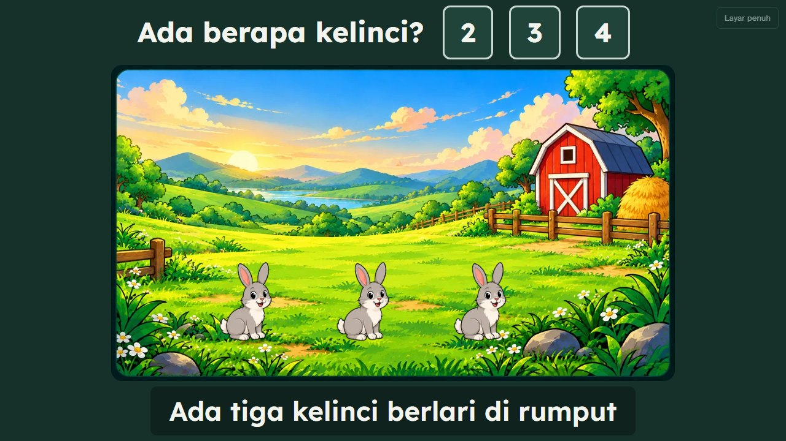
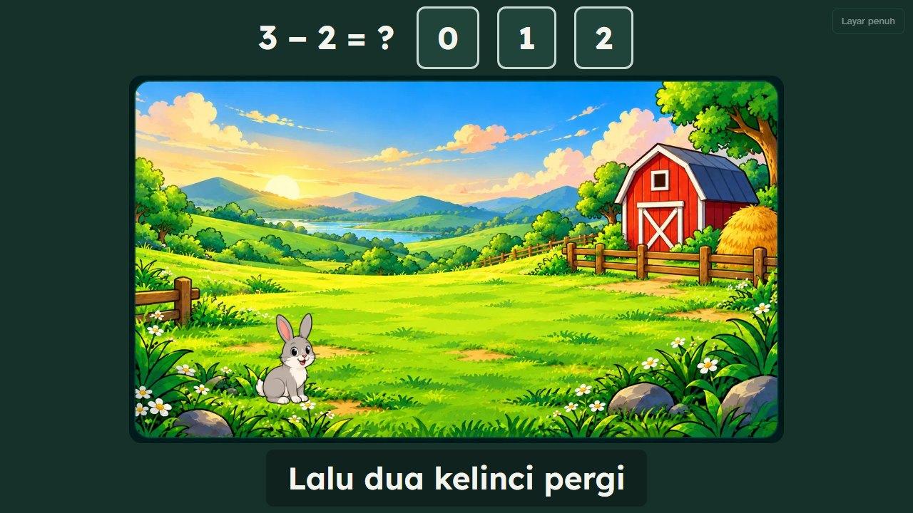
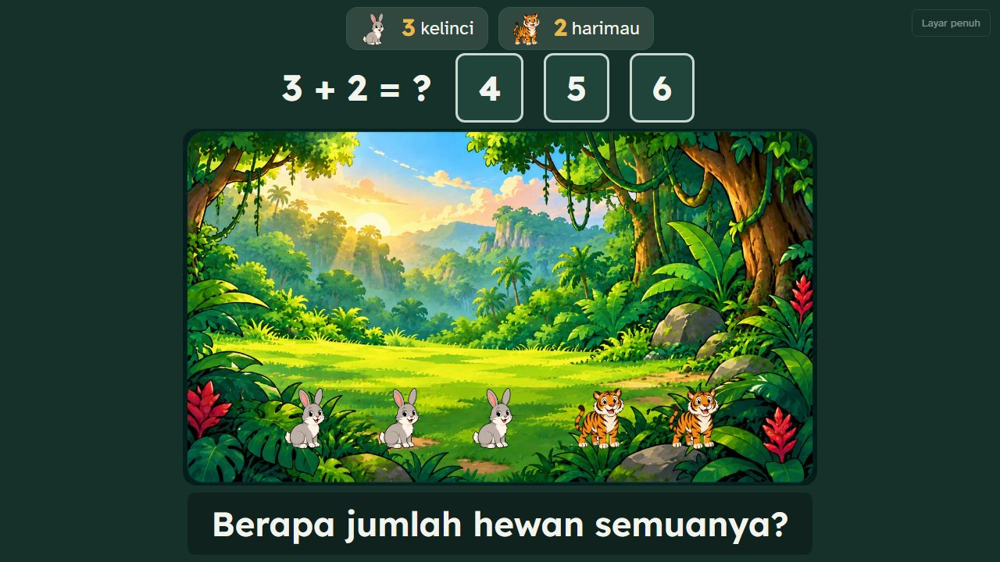
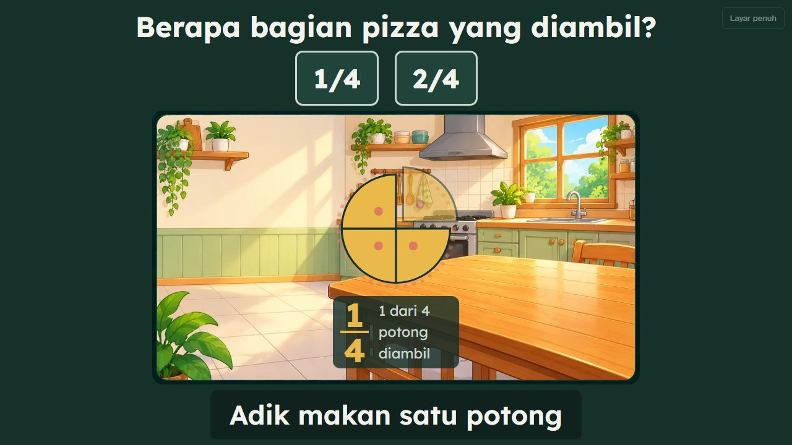
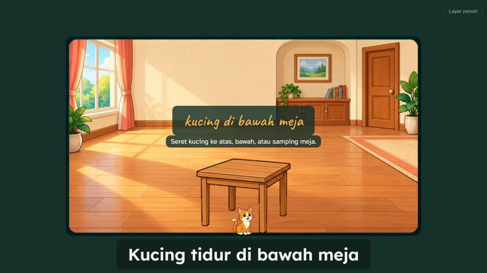
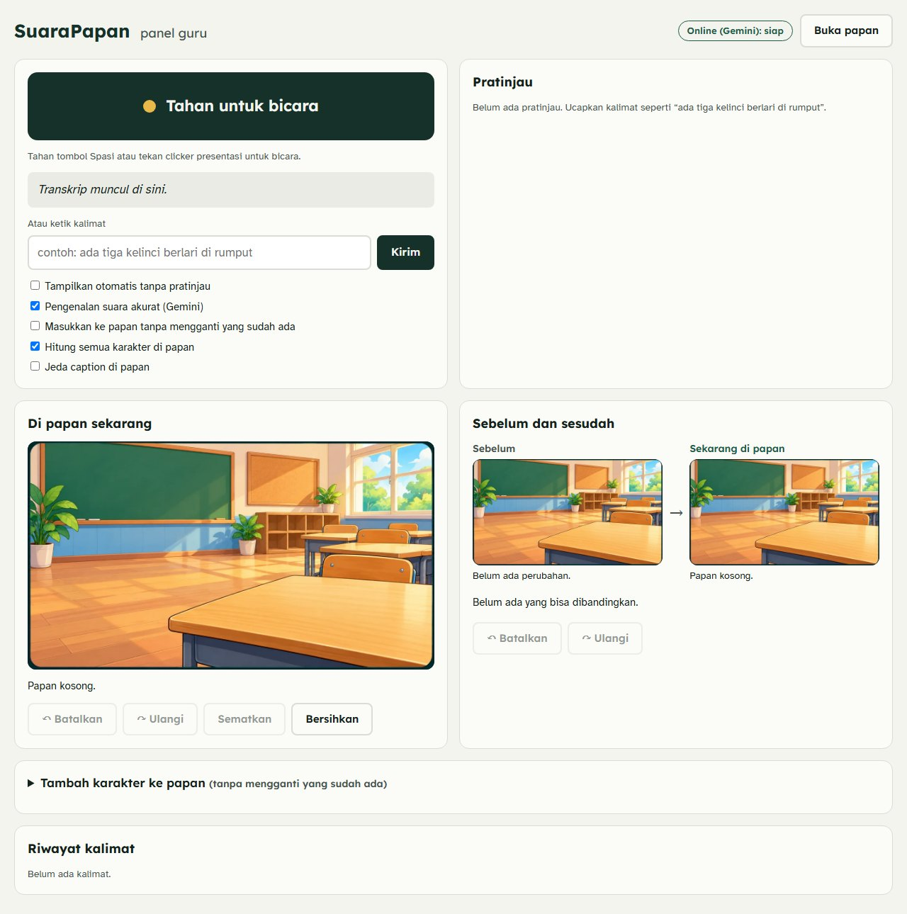
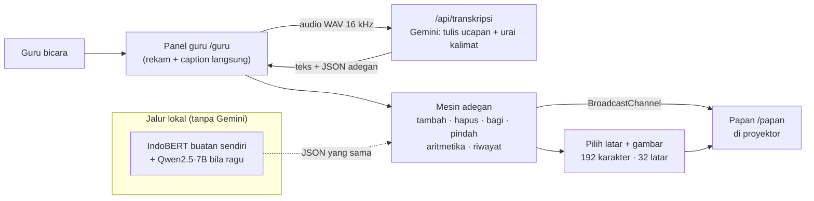

# SuaraPapan: guru bicara, papan bercerita

**Hackathon Dies Natalis ke-71 FMIPA UGM 2026**

> **In English:** SuaraPapan turns a teacher's spoken sentence into live captions *and* a touchable,
> animated scene on the classroom projector, so students who are deaf, have ADHD, autism, or an
> intellectual disability can follow primary-school maths. Each new sentence **changes the same scene**
> ("two rabbits leave" → `3 − 2 = ?`), and the teacher stays in control with preview, undo/redo and
> a before/after view. Live demo: <https://suarapapan.vercel.app/guru>

| | |
|---|---|
| **Coba langsung** | <https://suarapapan.vercel.app/guru> (Google Chrome, laptop) |
| **Video demo (1:59)** | [Unduh di Releases](https://github.com/Atatron/suarapapan/releases/tag/v1.0-hackathon) |
| **Proposal** | [`docs/pengajuan/Proposal_SUARA_PAPAN_10hal.pdf`](docs/pengajuan/Proposal_SUARA_PAPAN_10hal.pdf) |
| **Proses dan pengukuran** | [`docs/PROSES_PENGEMBANGAN.md`](docs/PROSES_PENGEMBANGAN.md) |

---

## Masalah dan solusi dalam satu menit

Di kelas, pelajaran datang lewat **satu jalur saja: suara guru**. Siswa tunarungu tidak
mendengarnya, siswa ADHD kehilangan fokus sebelum kalimat selesai, dan siswa dengan disabilitas
intelektual sulit membayangkan "tiga dikurangi dua" hanya dari kata-kata.

**SuaraPapan** menambahkan jalur kedua tanpa mengubah cara guru mengajar. Guru cukup berbicara seperti
biasa; papan di proyektor menampilkan **teks** (untuk yang tidak mendengar) dan **gambar yang bisa
disentuh** (untuk yang belajar lewat penglihatan dan gerak).



*Guru berkata "Ada tiga kelinci berlari di rumput." Papan menampilkan caption, tiga kelinci, dan soal
pilihan jawaban. Siswa maju dan mengetuk setiap kelinci: angka 1, 2, 3 muncul.*



*Kalimat berikutnya, "Lalu dua kelinci pergi.", **mengubah adegan yang sama** dan memunculkan soal
`3 − 2 = ?`. Gambar tidak diulang dari awal.*

---

## Coba sendiri (3 menit, tanpa instalasi)

1. Buka <https://suarapapan.vercel.app/guru> di **Google Chrome**.
2. Klik **Buka papan**. Jendela baru itu adalah layar proyektor; letakkan berdampingan.
3. **Tahan tombol Spasi** (atau tombol besar "Tahan untuk bicara") dan ucapkan kalimat, lalu lepaskan.
   Izinkan mikrofon saat Chrome bertanya. *Tanpa mikrofon:* ketik kalimat di kolom "Atau ketik kalimat".
4. Periksa **Pratinjau**, lalu klik **Tampilkan di papan** (atau centang "Tampilkan otomatis").
   Kalimat sederhana langsung tampil; kalimat rumit menunggu ±3–7 detik (Gemini, layanan gratis kadang lebih lambat).
   Bingung harus mengucapkan apa? Klik salah satu **Coba contoh** di bawah kolom ketik.

Contoh yang bisa dicoba **berurutan** (tekan **Bersihkan** di tempat bertanda ▸):

| Ucapkan | Yang terjadi |
|---|---|
| "Ada tiga kelinci berlari di rumput." | 3 kelinci di peternakan; siswa mengetuk untuk berhitung |
| "Lalu dua kelinci pergi." | 2 kelinci pergi; soal `3 − 2 = ?` |
| ▸ *Bersihkan* | |
| "Di hutan ada tiga kelinci dan dua harimau." | Latar berganti ke hutan; dua jenis karakter di satu papan |
| "Berapa jumlah hewan semuanya?" | Soal `3 + 2 = ?` dengan ikon dan jumlah tiap jenis |
| "Mana yang lebih banyak, kelinci atau harimau?" | Pilihan: kelinci / harimau / sama banyak |
| ▸ *Bersihkan* | |
| "Ibu punya satu pizza, kita bagi empat sama besar." | Pizza terbelah 4 potong yang bisa diketuk |
| "Adik makan satu potong." | Soal pecahan; jawaban `1/4` |
| ▸ *Bersihkan* | |
| "Kucing tidur di bawah meja." | Siswa **menyeret** kucing ke atas, bawah, atau samping meja |
| ▸ *Bersihkan* | |
| "Ada tujuh ikan berenang di kolam." lalu "Coba hitung, ada berapa ikan?" | Soal menghitung pilihan ganda |

Kontrol guru: **Batalkan** `Ctrl+Z` · **Ulangi** `Ctrl+Y` · kartu **Sebelum dan sesudah** · **Tambah
karakter ke papan** (192 karakter, cari lalu klik) · kotak centang untuk mode gabung dan hitung semua karakter.

> **Aturan penggabungan:** menyebut jenis karakter yang **baru** ("ada juga dua harimau") menambahkannya
> ke papan; menyebut jenis yang **sudah ada** memulai adegan baru. "Bersihkan" mengosongkan papan.

---

## Apa yang bisa dilakukan

| Pelajaran | Cara kerjanya |
|---|---|
| **Membilang** | Karakter muncul sesuai jumlah; ketuk satu per satu memunculkan angka 1, 2, 3, … |
| **Penjumlahan dan pengurangan** | "Datang dua lagi", "tiga pergi" mengubah adegan dan membuat soal; ada penjelasan seperti `3 kelinci + 3 yang datang = 6` |
| **Beberapa jenis karakter sekaligus** | Aritmetika memakai jumlah **semua** karakter (3 kelinci + 2 harimau = 5); pertanyaan *total*, *selisih*, *paling banyak*, *paling sedikit* |
| **Pecahan** | Benda dibagi sama besar; potongan diketuk dan diberi label `1/4` |
| **Posisi** | Benda di atas, bawah, atau samping benda lain; siswa menyeretnya |
| **Kendali guru** | Pratinjau sebelum tampil, Batalkan/Ulangi, sematkan papan, tambah karakter tanpa bicara |



*Dua jenis karakter di satu papan. Ikon dan jumlah di atas soal menjelaskan angka-angkanya.*

<table>
<tr>
<td width="50%"><br><sub>Pecahan: pizza 4 potong, satu diambil.</sub></td>
<td width="50%"><br><sub>Posisi: kucing di bawah meja, bisa diseret.</sub></td>
</tr>
</table>

**Panel guru** (laptop): pratinjau, papan saat ini, **Sebelum dan sesudah**, dan pilihan karakter.



---

## Mengapa ini berbeda

1. **Adegan yang berlanjut.** Aplikasi caption hanya menampilkan teks; pembuat gambar AI menggambar
   satu gambar per perintah. SuaraPapan mengingat adegan dan menerapkan **perubahan**: tambah, hapus,
   bagi, ambil, pindah. Soal aritmetika lahir dari perubahan itu.
2. **Model buatan sendiri, bukan hanya memanggil AI.** Kami melatih **IndoBERT** untuk mengenali jumlah,
   benda, aksi, tempat, posisi, dan peristiwa dalam kalimat guru. Median 8 ms di laptop (±100× lebih
   cepat dari LLM 7B pada uji kami), dan bisa berjalan tanpa internet. Versi online memakai Gemini; keduanya
   menghasilkan JSON yang sama.
3. **Tanpa gambar kejutan.** Semua ilustrasi (410 objek/karakter, 127 elemen tempat, 32 latar) dibuat dan dikurasi **sebelumnya**,
   tidak dibuat saat kelas berjalan. Cepat, konsisten, dan aman untuk siswa yang peka terhadap perubahan.
4. **Guru memegang kendali.** Tidak ada yang tampil ke siswa tanpa persetujuan guru (kecuali mode otomatis
   yang dipilih guru), dan setiap perubahan bisa dibatalkan.
5. **Pengaman terhadap kesalahan AI.** Rekaman disaring secara lokal dengan WebRTC VAD dan pemeriksaan derau sebelum dikirim untuk transkripsi.
   Hasil model divalidasi terhadap skema, kalimat, dan katalog aset; tafsiran ragu wajib ditinjau. Derau kelas nyata masih perlu diuji.

---

## Aksesibilitas

| Kebutuhan | Yang kami lakukan |
|---|---|
| Tunarungu, gangguan pendengaran | Caption langsung di papan; kata kunci (angka, benda) disorot |
| ADHD | Satu hal berubah pada satu waktu; pratinjau memberi guru jeda; bisa dijeda |
| Autisme, peka sensorik | Warna tenang, tanpa kedipan atau suara kejutan; animasi mengikuti pengaturan sistem *kurangi gerakan* (`prefers-reduced-motion`) |
| Disabilitas intelektual | Benda nyata yang bisa disentuh dan dihitung; angka dijelaskan dengan ikon dan jumlah |
| Disleksia, penglihatan rendah | Huruf **Lexend** dan **Atkinson Hyperlegible** (dirancang untuk keterbacaan); teks besar |
| Pengguna keyboard dan pembaca layar | Tombol, karakter, dan potongan pecahan bisa dioperasikan dengan keyboard; setiap adegan punya deskripsi teks tersembunyi (`aria-live`). **Menyeret** benda pada pelajaran posisi baru bisa dengan penunjuk (mouse/sentuh) |

> Kami **belum** mengukur kepatuhan WCAG secara formal dan belum menguji dengan siswa nyata (lihat Keterbatasan).

---

## Cara kerja



- **Suara.** Selama tombol ditahan, Chrome menampilkan caption langsung dan aplikasi merekam. Saat dilepas,
  rekaman dikirim ke server kami, yang meminta Gemini menuliskan ucapan **dengan daftar kosakata papan**
  (nama benda, tempat, bilangan) dan sekalian menguraikannya. Jika Gemini gagal, hasil Chrome dipakai.
- **Urutan pemahaman kalimat.** (1) Pola sederhana ("ada tiga kelinci", "dua kelinci pergi", "berapa semuanya?")
  dipahami langsung di browser oleh aturan bahasa (`web/src/lib/lokal.js`), dalam milidetik dan tanpa kuota.
  (2) Kalimat lain dikirim ke Gemini. (3) Jika Gemini tidak tersedia (kuota habis, sibuk, tanpa internet), tebakan
  terbaik aturan lokal dipakai, supaya pelajaran tidak berhenti. Ketiganya menghasilkan JSON yang sama.
- **Pemahaman kalimat.** Kalimat menjadi JSON: *entitas* (jumlah, benda, aksi, posisi), *peristiwa*
  (tambah/hapus/bagi/ambil/pindah), tempat, dan jenis pertanyaan.
- **Mesin adegan** (`web/src/scene/engine.js`) fungsi murni: adegan lama + JSON → adegan baru + soal.
  Karena murni, Batalkan/Ulangi cukup menyimpan adegan sebelumnya.
- **Tampilan.** Latar dipilih dari tempat yang disebut guru atau dari karakter di papan; karakter berdiri di
  tanah, air, atau meja sesuai area yang cocok pada latar itu.

---

## Bukti dan pengukuran

Kami mencatat **seberapa kuat** tiap bukti. Cerita lengkapnya (termasuk kesalahan yang kami temukan dan
perbaiki) ada di [`docs/PROSES_PENGEMBANGAN.md`](docs/PROSES_PENGEMBANGAN.md).

| Pengukuran | Hasil | Catatan jujur |
|---|---|---|
| Uji otomatis | **181 uji** (180 lulus, 1 dilewati) | `cd web && npm test` |
| IndoBERT vs LLM, 40 kalimat tulisan tim (**sebelum** perbaikan, 13 Okt) | IndoBERT **38/40**, 7,9 ms · LLM Qwen2.5-7B 38/40, 760 ms · gabungan 39/40 | Angka paling jujur; [berkasnya](ml/hasil/perbandingan_sebelum_perbaikan.md) disimpan sebelum perbaikan |
| Set yang sama **sesudah** perbaikan | 40/40 | **Bukan bukti independen**: set itu dipakai untuk memperbaiki |
| 51 kalimat bebas + 45 kalimat perintah | 51/51 · 45/45 | Disusun saat memperkuat model; berfungsi sebagai uji regresi |
| F1 validasi | 1,0 | Dari data buatan templat; tidak mewakili kalimat guru nyata |
| Penguraian kalimat **tanpa Gemini** (aturan lokal di browser) | 41 kalimat baru, dijalankan **sekali sebelum aturan disetel**: 39 benar, 1 ternyata salah label kami (jadi 40), 1 ditandai ragu dan diserahkan ke Gemini | Ditulis oleh tim pengembang, bukan guru, dan benda hanya yang ada di pustaka. 136 kalimat lama dipakai **menyetel** aturan (100%, tidak independen) |
| Pengenalan suara (Gemini) | **0 salah dari 124 kata**, 2 putaran, separuh dengan derau kelas | Suara **sintetis**; suara anak, aksen daerah, dan gema belum diuji |
| Rekaman hening atau derau | 0 dari 12 klip derau (desis, gumam, dengung) menghasilkan kalimat; hening digital juga ditolak | Satu klip kena batas waktu layanan; derau buatan, bukan kelas sungguhan |
| Kecepatan versi online | ±3–7 detik setelah tombol dilepas | Gemini tingkat gratis; kadang lebih lambat |
| **100 kalimat guru asli** | **Belum dijalankan** (baru 4 terkumpul) | Ini uji yang paling kami percaya; halaman `/uji` siap untuk uji suara nyata |

---

## Penggunaan AI

| Alat | Peran | Dipakai di |
|---|---|---|
| **IndoBERT** (`indobenchmark/indobert-base-p1`), kami latih ulang | Memahami kalimat guru: jumlah, benda, aksi, tempat, posisi, peristiwa | Produk (jalur lokal) |
| **Gemini** (Google) | Menuliskan ucapan guru dan menguraikan kalimat pada versi online | Produk (online) |
| **Qwen2.5-7B** lewat Ollama | Cadangan bila IndoBERT ragu (<85% yakin) | Produk (jalur lokal) |
| **Web Speech API** (Chrome) | Caption langsung saat guru bicara | Produk |
| **Pembuat gambar generatif** | Membuat 192 karakter dan 32 latar **sebelumnya**; tidak dipakai saat aplikasi berjalan | Pengembangan |
| **Claude Code** (Anthropic) | Menulis dan menguji kode, menganalisis hasil | Pengembangan |
| **edge-tts** | Suara sintetis untuk narasi video dan untuk menguji pengenalan suara | Video, pengujian |

---

## Privasi dan keamanan

- Suara direkam **hanya saat tombol ditahan** dan dikirim ke server kami hanya untuk satu kali pemeriksaan.
  **Kode kami tidak menyimpan rekaman.** Tidak ada akun atau basis data.
- Pada versi online, rekaman diproses oleh **Google (Gemini API)**. Ketentuan Google untuk tingkat
  gratis dapat mengizinkan data dipakai untuk pengembangan produk (periksa ketentuan terbaru).
  **Untuk sekolah sungguhan, gunakan tingkat berbayar atau jalur lokal.**
- Kunci API disimpan sebagai variabel lingkungan di Vercel, **tidak ada di kode**. Berkas `.env*` diabaikan git.

---

## Keterbatasan dan rencana

Kami lebih suka juri mendengarnya dari kami:

1. **Belum diuji pada suara manusia nyata**, apalagi anak-anak, aksen daerah, atau kelas yang bising.
2. **100 kalimat guru asli belum diuji**; angka IndoBERT di atas berasal dari data kami sendiri.
3. **Belum ada uji coba dengan guru dan siswa nyata.** Pilot di SLB B dan SD inklusi ada di rencana.
4. **Pengenalan suara belum bisa offline.** Pemahaman kalimat (IndoBERT) bisa lokal, tetapi suara ke teks
   masih butuh internet. Mode offline dengan `faster-whisper` baru rencana.
5. **Versi online tunduk pada kuota layanan Gemini.** Batas bergantung pada model dan akun. Aturan lokal di browser
   menangani pola sederhana tanpa kuota; kalimat yang memerlukan model diperiksa guru sebelum ditampilkan.
   Galat kuota/jaringan mempertahankan kalimat dan menyediakan jalur ketik untuk melanjutkan pelajaran.
6. **Cakupan:** matematika kelas 1–3. Subjek di luar katalog mempertahankan papan dan meminta kalimat diperjelas. SVG/emoji berlabel tetap tersedia sebagai pemulihan jika file gambar gagal dimuat.
7. **Gambar pose gerak** (berlari, terbang) belum dibuat; alat pemotongnya sudah (`tools/bangun_aksi.py`).
   Saat ini gerakan memakai animasi sederhana.
8. **Jalur lokal (Python/Ollama)** belum mengenal pertanyaan *total/selisih/paling banyak*; versi online sudah.

---

## Alur guru dan perbaikan audit

1. **Masukkan kalimat** lewat ketikan atau tahan tombol bicara.
2. **Periksa pratinjau**: jenis, jumlah, letak, serta catatan batas/ketidakpastian.
   Mode otomatis hanya berlaku untuk hasil yang pasti. Koreksi, tafsiran ragu,
   serta seluruh rangkaian pratinjau yang bergantung padanya tetap perlu persetujuan.
3. **Tampilkan di papan**. Batalkan/Ulangi, Bersihkan, dan perubahan manual
   membatalkan permintaan lama sehingga hasil terlambat tidak mengambil alih papan.

Gunakan **Buka papan kelas ini**. URL `?sesi=...` memisahkan kelas; panel guru
terbaru pada sesi yang sama mengambil alih kendali. Sambungan memakai
BroadcastChannel pada **browser, profil, origin, dan perangkat yang sama**.
Papan, caption, serta riwayat disimpan secara lokal untuk pemulihan saat muat ulang.
Snapshot yang berusia lebih dari tujuh hari tidak dipakai untuk pemulihan. Rekaman audio tidak ikut disimpan.
**Latar sederhana** menampilkan papan hijau dengan garis tepi sprite.

Rekaman untuk transkripsi aplikasi melewati filter WAV lokal dan server.
Caption langsung Web Speech memakai jalur vendor browser yang terpisah;
filter WAV ini tidak menjamin seluruh lalu lintas pengenal browser ikut tersaring.
Kegagalan izin/perangkat menyisakan kolom ketik sebagai jalur melanjutkan pelajaran.

Lihat [audit dan status perbaikan](docs/audit/2026-10-16-voice-scene-audit.md).
Perbaikan diverifikasi lokal. Investigasi/deployment Vercel ditunda atas permintaan pengguna.

## Untuk pengembang

| Folder | Isi |
|---|---|
| `web/` | Aplikasi: React + Vite. `src/guru`, `src/papan`, `src/scene` (mesin adegan, latar, pustaka), `src/lib` (suara); `api/` fungsi serverless Vercel (`parse`, `transkripsi`, `kesehatan`); `public/aset` (gambar) |
| `ml/` | IndoBERT: `buat_dataset.py`, `latih_ner.py`, `ner.py`, `evaluasi.py`; server lokal `serve.py`; `hasil/` |
| `tools/` | Pembuat aset: `bangun_aset.py` (sprite sheet → pustaka gambar), `bangun_latar.py` (32 latar + pasangan karakter), `bangun_aksi.py` |
| `tests/` | Kalimat uji (40 + 51 + 45 + 41 untuk aturan lokal) dan kalimat guru asli |
| `docs/` | Proses, tangkapan layar, materi pengajuan |
| `video/` | Sumber video demo (dibuat dengan kode) |

**Menjalankan aplikasi web** (Node.js 22 atau lebih baru; diuji dengan 24):

```bash
cd web
npm install
# Pakai server online yang sudah berjalan (tanpa kunci di laptop):
SUARAPAPAN_API=https://suarapapan.vercel.app npm run dev     # PowerShell: $env:SUARAPAPAN_API="https://suarapapan.vercel.app"; npm run dev
# atau pakai kunci Gemini sendiri:
echo GEMINI_API_KEY=isi_kunci_anda > .env.local && npm run dev
npm test                                                     # 181 uji otomatis
```

Buka `http://127.0.0.1:5173/guru`. Deploy: `cd web && vercel deploy --prod` dengan variabel `GEMINI_API_KEY`
(opsional `GEMINI_MODEL`).

<details>
<summary><b>Jalur lokal: IndoBERT + Ollama (Windows)</b></summary>

Butuh Python 3.12, [Ollama](https://ollama.com) dengan model `qwen2.5:7b-instruct`, dan GPU untuk melatih.
Bobot model (±500 MB) tidak disimpan di GitHub; buat ulang dalam ±2 menit:

```bash
cd ml
python -m venv .venv
.venv\Scripts\pip install fastapi==0.115.6 "uvicorn[standard]==0.34.0" httpx==0.28.1
.venv\Scripts\pip install torch --index-url https://download.pytorch.org/whl/cu128
.venv\Scripts\pip install transformers datasets seqeval accelerate matplotlib
.venv\Scripts\python buat_dataset.py      # kalimat berlabel → data/
.venv\Scripts\python latih_ner.py         # → model/indobert-suarapapan + hasil/metrik_latih.json
.venv\Scripts\python evaluasi.py          # IndoBERT vs LLM vs gabungan → hasil/perbandingan.md
.venv\Scripts\python uji_sulit.py - kalimat_uji_sulit.json      # uji 51 kalimat bebas
.venv\Scripts\python -m uvicorn serve:app --port 8000          # server lokal untuk `npm run dev`
```

Server memakai IndoBERT lebih dulu; jika keyakinannya di bawah 85%, kalimat diteruskan ke LLM (Ollama).
</details>

---

*SuaraPapan dibuat untuk Hackathon Dies Natalis ke-71 FMIPA UGM 2026. Ilustrasi dibuat dengan alat
generatif dan dikurasi tim. Belum ada lisensi terbuka yang ditetapkan.*

### Katalog dan validasi regresi

`web/src/scene/sinonim.json` menyimpan sinonim yang didukung. Katalog kanonik
`katalog.json` dibangkitkan dari pustaka/file nyata dan pemetaan 39 sprite sheet;
browser, prompt Gemini, server lokal, dan pembuat data memakai katalog ini.
Nama paling spesifik menang; subjek asing tidak diganti dengan benda yang mirip.

```powershell
node tools/bangun_katalog.mjs --check
npm --prefix web test
npm --prefix web run build
python -m unittest discover -s ml -p "test_*.py"
python -m unittest discover -s tools -p "test_*.py" # perlu NumPy + Pillow + SciPy
```

Untuk mengubah sinonim, jalankan `node tools/bangun_katalog.mjs`, lalu
`python ml/buat_dataset_aset.py`. Dataset baru adalah kalimat sintetis dengan
keluarga kalimat validasi/uji terpisah; ini bukan hasil pengujian guru asli.
`python ml/persiapan_latih.py` memeriksa dependensi/bobot tanpa mengunduh model.
Belum ada bobot IndoBERT baru yang dilatih pada perubahan ini. Pelatihan opsional
memerlukan paket ML dan dijalankan terpisah melalui `--train`.
